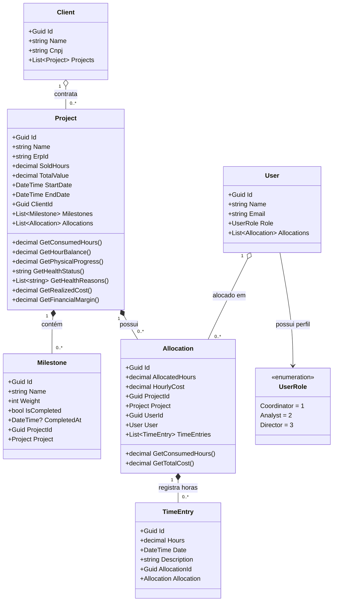
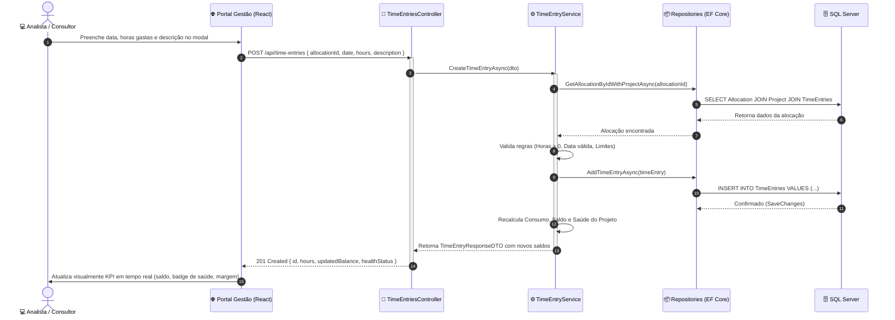

# 🌐 Portal de Gestão — Painel de Projetos (Case PVT)

Sistema completo de monitoramento, controle de saúde financeira e física, alocação de equipe e apontamento de horas para gestão de projetos.

---

## 📑 Sumário

- [Visão Geral](#-visão-geral)
- [Arquitetura da Solução](#-arquitetura-da-solução)
- [Diagrama de Classes e Modelagem de Domínio](#-diagrama-de-classes-e-modelagem-de-domínio)
- [Diagrama de Fluxo e Sequência](#-diagrama-de-fluxo-e-sequência)
- [Regras de Negócio e Cálculos](#-regras-de-negócio-e-cálculos)
- [Perfis de Acesso (RBAC)](#-perfis-de-acesso-rbac)
- [Design da API (Endpoints e Contratos)](#-design-da-api-endpoints-e-contratos)
- [Decisões de Arquitetura e Trade-offs (ADRs)](#-decisões-de-arquitetura-e-trade-offs-adrs)
- [Como a Solução Evoluiria (Roadmap de Engenharia)](#-como-a-solução-evoluiria-roadmap-de-engenharia)
- [Tecnologias Utilizadas](#-tecnologias-utilizadas)
- [Como Executar o Projeto Localmente (Startup)](#-como-executar-o-projeto-localmente-startup)
- [Como Executar os Testes](#-como-executar-os-testes)
- [Estratégia de Versionamento e Padrões de Commit](#-estratégia-de-versionamento-e-padrões-de-commit)

---

## 🚀 Visão Geral

O **Portal de Gestão** foi desenvolvido para atender às necessidades operacionais e executivas de monitoramento de projetos. A plataforma permite:
- Acompanhar a **saúde do projeto** em tempo real com base em horas consumidas vs. avanço físico.
- Calcular a **margem de lucro financeira** em moeda corrente (`R$`).
- Gerenciar marcos contratuais (**milestones**) com recálculo automático de avanço físico.
- Alocar analistas com controle de **horas previstas** e **custo/hora** individualizado.
- Registrar apontamentos de horas (**Time Entries**) com validação de apontamentos anteriores e recálculo instantâneo de indicadores.

---

## 🏛️ Arquitetura da Solução

O projeto segue os princípios de **Clean Architecture** e **Domain-Driven Design (DDD)** simplificado, garantindo desacoplamento entre regras de negócio, persistência e interfaces de apresentação.

```text
case-pvt/
├── portal-gestao-api/              # Backend .NET 9 Web API
│   ├── portal-gestao-api/
│   │   ├── Domain/                 # Núcleo: Entidades Ricas, Enums e Interfaces
│   │   │   ├── Entities/           # Project, Milestone, Allocation, TimeEntry, User, Client
│   │   │   └── Interfaces/         # IProjectRepository, IAllocationRepository, etc.
│   │   ├── Application/            # Casos de uso e orquestração
│   │   │   ├── DTOs/               # Contratos de entrada e saída
│   │   │   └── Services/           # ProjectService, AllocationService, etc.
│   │   ├── Infrastructure/         # Acesso a dados e integrações
│   │   │   ├── Data/               # AppDbContext (EF Core) e Seeding de Dados
│   │   │   └── Repositories/       # Implementação concreta dos repositórios
│   │   ├── Controllers/            # Endpoints REST (Projects, TimeEntries, Users, Clients)
│   │   └── Program.cs              # Injeção de dependências, CORS e Swagger
│   └── portal-gestao-tests/        # Testes Unitários com xUnit e FluentAssertions
│
└── portal-gestao-app/              # Frontend React 18 + TypeScript + Vite
    ├── src/
    │   ├── components/             # Sidebar, Modais, Cards, Componentes reutilizáveis
    │   ├── context/                # AuthContext (Simulação de perfil Coordenador/Analista)
    │   ├── pages/                  # Dashboard, Projetos, Detalhes do Projeto, etc.
    │   ├── services/               # Cliente HTTP Axios configurado para a API
    │   ├── types/                  # Tipagem TypeScript estrita e contratos de API
    │   └── utils/                  # Formatadores (moeda BRL, datas, percentuais decimais)
```

---

## 📐 Diagrama de Classes e Modelagem de Domínio

O domínio foi desenhado seguindo os princípios de **Domain-Driven Design (DDD)** com entidades ricas, onde as regras de cálculo e saúde do projeto residem diretamente nas entidades de negócio:



---

## 🔄 Diagrama de Fluxo e Sequência

O fluxo abaixo demonstra o ciclo de vida completo de um **Apontamento de Horas** realizado pelo analista, com validação de regras de negócio, persistência atômica no banco de dados e recálculo automático de saldos e saúde:



## ⚙️ Regras de Negócio e Cálculos

### 1. Saldo de Horas (Prazo)
$$\text{Saldo de Horas} = \text{Horas Vendidas} - \sum \text{Horas Apontadas}$$

### 2. Percentual de Avanço Físico
$$\text{Avanço Físico (\%)} = \sum_{\text{milestone.IsCompleted = true}} \text{milestone.Weight}$$

### 3. Indicador e Diagnóstico de Saúde do Projeto
A relação entre a taxa de consumo de horas e o avanço físico define a saúde do projeto, acompanhada pelo método `GetHealthReasons()` que gera diagnósticos acionáveis:
- **🟢 Saudável:** $\text{Taxa de Consumo} \le \text{Avanço Físico}$.
- **🟡 Atenção:** $\text{Taxa de Consumo} > \text{Avanço Físico}$ em até 15%, ou consumo de horas $\ge 80\%$.
- **🔴 Crítico:** Consumo superou o avanço em mais de 15%, horas vendidas estouradas ($> 100\%$) ou data de término expirada com projeto incompleto.

> O sistema disponibiliza no frontend tooltips nas listagens e um **Painel de Diagnóstico Operacional** na página de detalhes, discriminando com exatidão os motivos e orientando a equipe sobre descompassos, esgotamento de saldo e prazos contratuais.

### 4. Saúde Financeira (Margem de Lucro)
$$\text{Custo Realizado} = \sum (\text{TimeEntry.Hours} \times \text{Allocation.HourlyCost})$$
$$\text{Margem Financeira} = \text{Valor Total do Contrato} - \text{Custo Realizado}$$

---

## 👥 Perfis de Acesso (RBAC)

Para atender à governança corporativa, os dados financeiros e ações administrativas são segregados por perfil:

| Recurso / Funcionalidade | 👔 Coordenador | 💻 Analista |
| :--- | :---: | :---: |
| Visualizar Dashboard Geral e Projetos | ✅ Sim | ✅ Apenas projetos vinculados |
| Visualizar Avanço Físico e Marcos | ✅ Sim | ✅ Sim |
| Apontar Horas (Time Entries) | ✅ Sim | ✅ Sim |
| Visualizar Valor Total do Contrato | ✅ Sim | ❌ Oculto / Restrito |
| Visualizar Margem de Lucro em R$ | ✅ Sim | ❌ Oculto / Restrito |
| Visualizar Custo/Hora das Alocações | ✅ Sim | ❌ Oculto / Restrito |
| Criar Novos Projetos | ✅ Sim | ❌ Não |
| Criar, Editar e Excluir Marcos (Milestones) | ✅ Sim | ❌ Não |
| Alocar Colaboradores na Equipe | ✅ Sim | ❌ Não |
| Gerenciar Horas e Taxa da Alocação (Editar) | ✅ Sim | ❌ Não |
| Desalocar Analista da Equipe (Remover) | ✅ Sim | ❌ Não |

---

## 🔌 Design da API (Endpoints e Contratos)

A API segue padrões RESTful rigorosos, utilizando verbos semânticos, códigos de status HTTP apropriados e DTOs específicos para evitar *over-fetching* ou exposição indevida de dados do modelo interno:

| Método | Endpoint | Descrição | Status Sucesso | Regras & Validações |
| :--- | :--- | :--- | :---: | :--- |
| `GET` | `/api/projects` | Lista todos os projetos da carteira | `200 OK` | Retorna indicadores calculados (avanço, saúde, saldos) |
| `GET` | `/api/projects/{id}` | Detalhes do projeto, alocações e marcos | `200 OK` | Traz árvore completa de relacionamento do projeto |
| `POST` | `/api/projects` | Criação de novo projeto | `201 Created` | Valida horas vendidas > 0, valor > 0, datas válidas |
| `POST` | `/api/projects/{id}/milestones` | Cadastro de marco de entrega | `201 Created` | Valida peso entre 1 e 100% |
| `PUT` | `/api/projects/{id}/milestones/{mId}` | Edição de nome e peso do marco | `200 OK` | Valida peso > 0, recalcula avanço físico |
| `DELETE` | `/api/projects/{id}/milestones/{mId}` | Exclusão de marco de entrega | `204 No Content` | Remove etapa e recalcula avanço físico e saúde |
| `PATCH` | `/api/projects/{id}/milestones/{mId}/toggle` | Alterna status de conclusão do marco | `200 OK` | Atualiza data de conclusão e recalcula avanço físico |
| `POST` | `/api/projects/{id}/allocations` | Aloca analista na equipe do projeto | `201 Created` | Valida se analista já não está alocado, taxa horária > 0 |
| `PUT` | `/api/projects/{id}/allocations/{aId}` | Atualiza horas previstas, taxa e vigência | `200 OK` | Valida horas > 0, taxa > 0, recalcula margem financeira |
| `DELETE` | `/api/projects/{id}/allocations/{aId}` | Desaloca analista da equipe do projeto | `204 No Content` | Bloqueia se analista possuir apontamentos de horas vinculados |
| `POST` | `/api/time-entries` | Apontamento de horas em uma alocação | `201 Created` | Valida horas > 0, data não futura e alocação existente |
| `GET` | `/api/users` | Listagem de usuários (analistas/coordenadores) | `200 OK` | Utilizado para seleção de perfis e alocação de equipe |
| `GET` | `/api/clients` | Listagem de clientes corporativos | `200 OK` | Utilizado na criação e vínculo de projetos |
| `GET` | `/openapi/v1.json` | Especificação OpenAPI 3.0 nativa .NET 9 | `200 OK` | Documentação interoperável para clientes e SDKs |

---

## ⚖️ Decisões de Arquitetura e Trade-offs (ADRs)

Para garantir transparência técnica na avaliação, destacamos as principais decisões tomadas durante a concepção da solução e seus respectivos trade-offs:

### 1. Monólito Modular (.NET 9) vs. Microsserviços
* **Decisão:** Arquitetura monolítica modular, dividida logicamente em camadas (*Domain*, *Application*, *Infrastructure*, *Presentation*).
* **Motivação:** O domínio de gestão de projetos possui forte integridade referencial (Apontamento depende de Alocação que depende de Projeto).
* **Trade-off:** Evitou complexidade acidental (mensageria assíncrona, orquestração de sagas e *distributed transactions* de 2PC) para manter consistência transacional ACID garantida pelo SQL Server no cálculo de saldos.

### 2. Rich Domain Model (DDD) vs. Anemic Domain Model
* **Decisão:** Encapsular fórmulas de saúde (`GetHealthStatus`), consumo de horas (`GetConsumedHours`) e avanço físico (`GetPhysicalProgress`) diretamente nas entidades de Domínio.
* **Motivação:** A inteligência do negócio nunca deve se dispersar em *controllers* ou ficar duplicada em múltiplos serviços.
* **Trade-off:** Permitiu cobrir as regras de negócio complexas com testes unitários puros rápidos (xUnit), desacoplados de banco de dados ou mocks externos.

### 3. Segregação de Governança (RBAC) na Apresentação e Domínio
* **Decisão:** Ocultação de dados financeiros para o analista e simulação de persona no cabeçalho/contexto.
* **Motivação:** Em fábricas de software e consultorias (cenário TOTVS), consultores técnicos não devem ter visibilidade de custos/hora dos colegas nem da margem contratual do projeto.
* **Trade-off:** Garante governança de dados sensíveis corporativos sem impor fricção de autenticação complexa no ambiente local de avaliação.

### 4. Playwright para Testes End-to-End
* **Decisão:** Adoção do Microsoft Playwright com execução multi-viewport e validação de responsividade mobile.
* **Motivação:** Suporte nativo e veloz a auto-wait, fixtures de personas e execução em navegadores reais *headless*.
* **Trade-off:** Adiciona uma etapa a mais no pipeline de testes em relação a testes unitários, mas assegura que 100% dos fluxos reais do usuário (desktop e mobile) funcionem sem regressão.

### 5. Segurança da Documentação OpenAPI/Swagger em Produção
* **Decisão:** A especificação OpenAPI (`/openapi/v1.json`) está condicionada estritamente ao ambiente de desenvolvimento (`if (app.Environment.IsDevelopment())`).
* **Motivação:** Em conformidade com as diretrizes da **OWASP API Security Top 10** (*API9: Improper Inventory Management*), documentações interativas nunca devem ficar expostas publicamente em produção, pois facilitam *endpoint discovery* e engenharia reversa por atacantes.
* **Trade-off:** Em produção, a integração de terceiros deve ser realizada via *Developer Portal* autenticado ou contratos estáticos versionados, mantendo o host produtivo blindado contra enumeração.

---

## 🔮 Como a Solução Evoluiria (Roadmap de Engenharia)

Caso este projeto avançasse para um estágio corporativo em larga escala em produção, as seguintes evoluções arquiteturais seriam implementadas:

1. **Autenticação e SSO Federado:**
   * Substituição do seletor de personas local por autenticação OpenID Connect (OIDC) / OAuth2 integrado a Microsoft Entra ID (antigo Azure AD), Keycloak ou Okta, com validação de claims JWT no backend.
2. **Histórico e Snapshots Temporais (S-Curve):**
   * Agendador em background com **Hangfire** ou **Quartz.NET** para tirar *snapshots* diários do progresso físico e financeiro, viabilizando gráficos de Curva S (previsto vs. realizado ao longo do tempo).
3. **Cache de Alta Performance com Redis:**
   * Implementação de padrão *Cache-Aside* no endpoint de KPIs executivos com invalidação reativa orientada a eventos (*domain events*) disparados ao criar marcos ou apontar horas.
4. **Relatórios e Exportações Assíncronas:**
   * Geração assíncrona de relatórios em PDF/Excel com fila de processamento (RabbitMQ ou Azure Service Bus), evitando travamento da thread HTTP em exportações de carteiras com centenas de projetos.
5. **Observabilidade Completa:**
   * Instrumentação com **OpenTelemetry**, logs estruturados com **Serilog** enviados para OpenSearch/Elasticsearch, e dashboards de APM no Grafana/Prometheus monitorando latência e taxa de erro.

---

## 🛠️ Tecnologias Utilizadas

- **Backend:** C# / .NET 9, Entity Framework Core 9, SQL Server, OpenAPI 3.0.
- **Frontend:** React 18, TypeScript, Vite, Lucide Icons, Vanilla CSS com design tokens corporativos.
- **Testes & Qualidade:**
  - **E2E:** Playwright (Chromium headless, auto-wait, fixtures de personas e validação de RBAC).
  - **Unitários:** xUnit, FluentAssertions (.NET 9).
- **DevOps & Infra:** Docker, Docker Compose, Git.

---

## 💻 Como Executar o Projeto Localmente

### Pré-requisitos
- [Docker](https://www.docker.com/) e Docker Compose
- [.NET 9 SDK](https://dotnet.microsoft.com/download)
- [Node.js 18+](https://nodejs.org/) e npm

### 1. Iniciar o Banco de Dados (SQL Server via Docker)
Na pasta `portal-gestao-api`:
```bash
docker compose up -d database
```

### 2. Executar a API Backend (.NET 9)
```bash
cd portal-gestao-api/portal-gestao-api
dotnet run
```
*A API será iniciada em `http://localhost:5062` e executará o seed automático de usuários, clientes e projetos no banco de dados.*

### 3. Executar o Frontend (React + Vite)
Em um novo terminal, na pasta `portal-gestao-app`:
```bash
cd portal-gestao-app
npm install
npm run dev
```
*O frontend estará disponível em `http://localhost:5173`.*

---

## 🧪 Como Executar os Testes

### 1. Testes End-to-End (E2E com Playwright)
Com a API e o Frontend em execução (ou o Playwright inicializa o dev server automaticamente):
```bash
cd portal-gestao-app
npm run test:e2e
```
*Para rodar com a interface interativa visual do Playwright:*
```bash
npm run test:e2e:ui
```
**Cenários cobertos pelos testes E2E:**
- ✅ **`auth-rbac.spec.ts`:** Login com personas, exibição de métricas executivas/financeiras para Coordenação e ocultação estrita de dados confidenciais para o Analista.
- ✅ **`project-detail-milestones.spec.ts`:** Navegação para detalhes do projeto, validação de equipe/marcos e alternância (*toggle*) de milestones com recálculo do avanço físico.
- ✅ **`time-entry-modal.spec.ts`:** Abertura do modal de apontamento, uso dos *chips* rápidos de horas e cancelamento/fechamento.
- ✅ **`responsive-mobile.spec.ts`:** Responsividade mobile (viewport 375x667), gaveta lateral deslizante (*mobile drawer*), toque fora (*backdrop*) e rolagem de tabelas densas.

### 2. Testes Unitários de Domínio (.NET 9 com xUnit)
```bash
cd portal-gestao-api
dotnet test
```

---

## 📖 Especificação OpenAPI 3.0

Com a API em execução em ambiente local/desenvolvimento, acesse o documento de especificação OpenAPI 3.0 nativo em:
👉 **`http://localhost:5062/openapi/v1.json`**

> 🔒 **Boas Práticas de Segurança em Produção:**  
> Em conformidade com o padrão **OWASP API Security Top 10** (*API9: Improper Inventory Management*), o endpoint de documentação OpenAPI/Swagger está condicionado estritamente à diretiva `if (app.Environment.IsDevelopment())` no [Program.cs](file:///home/vitordalvi/Desktop/repositories/case-pvt/portal-gestao-api/portal-gestao-api/Program.cs#L56-L59).  
> Em ambiente de produção (`ASPNETCORE_ENVIRONMENT=Production`), o endpoint é desativado por padrão para mitigar riscos de *endpoint discovery*, enumeração automatizada e exposição da superfície de ataque.

### Principais Endpoints:
- `GET /api/projects` — Lista todos os projetos com indicadores consolidados.
- `GET /api/projects/{id}` — Detalhes completos do projeto, alocações e marcos.
- `POST /api/projects` — Criação de um novo projeto.
- `POST /api/projects/{id}/milestones` — Adição de um novo marco.
- `PATCH /api/projects/{id}/milestones/{milestoneId}/toggle` — Alterna conclusão do marco e recalcula saúde.
- `POST /api/projects/{id}/allocations` — Alocação de analista com taxa horária e meta de horas.
- `POST /api/time-entries` — Apontamento de horas em uma alocação.
- `GET /api/users` — Listagem de analistas e coordenadores para alocação.
- `GET /api/clients` — Listagem de clientes para novos contratos.

---

## 🏷️ Estratégia de Versionamento e Padrões de Commit

### 1. Versionamento Semântico (SemVer 2.0.0)
O projeto adota o padrão `MAJOR.MINOR.PATCH`:
- **MAJOR (`1.x.x`):** Mudanças incompatíveis na API pública ou quebra de contrato.
- **MINOR (`x.1.x`):** Novas funcionalidades retrocompatíveis (ex: adição de relatórios ou exportação CSV).
- **PATCH (`x.x.1`):** Correções de bugs e ajustes pontuais de interface sem alteração de contratos.

### 2. Padrão de Commits (Conventional Commits)
Todas as alterações no repositório seguem convenções semânticas:
- `feat:` Nova funcionalidade para o usuário ou API.
- `fix:` Correção de bug.
- `docs:` Alterações e melhorias em documentações ou diagramas.
- `refactor:` Mudança na estrutura do código sem alterar regras de negócio ou comportamento.
- `test:` Adição ou modificação de suítes de testes unitários ou de integração.
- `chore:` Atualizações de build, dependências ou configurações de ambiente.

### 3. Estrutura de Branches
- `main`: Branch de código estável, pronta para deploy em ambiente produtivo.
- `develop`: Branch de integração contínua das features concluídas.
- `feat/<nome-da-feature>`: Branches de curta duração para desenvolvimento isolado de funcionalidades.
