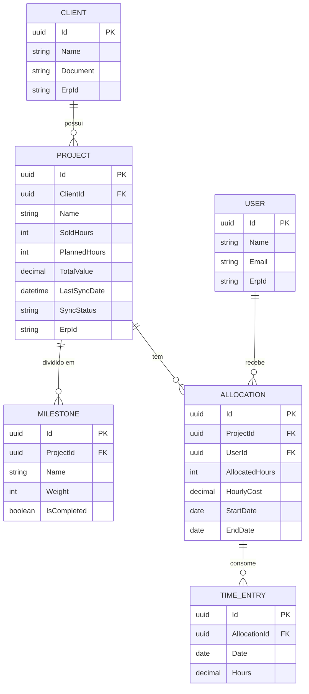
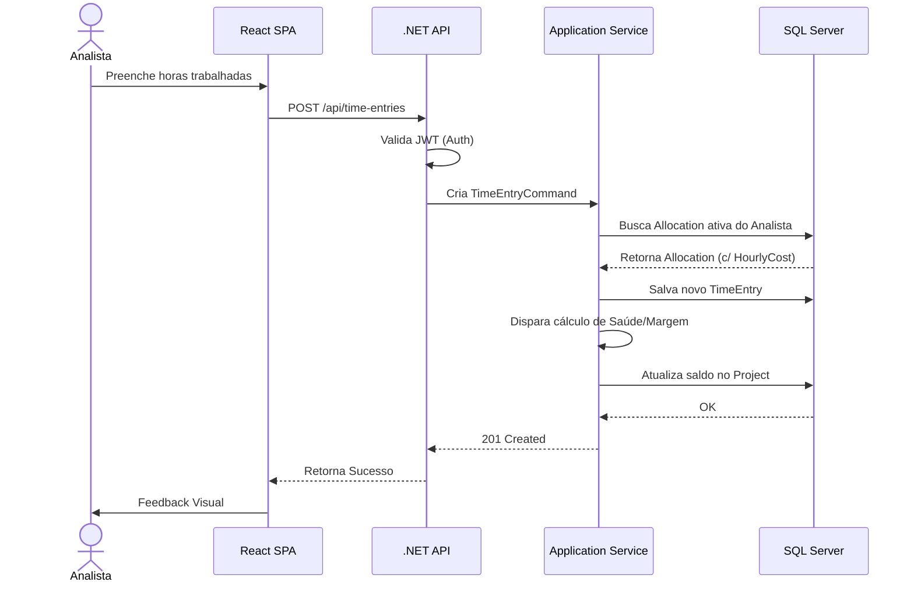

# Portal de Gestão - Painel de Projetos (Case PVT)

Este repositório contém a solução técnica para o módulo "Painel de Projetos", projetado para monitorar a saúde, alocações e o progresso financeiro e físico dos projetos.

## Parte 1 — Design e Arquitetura

### 1. Modelagem do Domínio

A modelagem foi desenhada pensando na flexibilidade de papéis e na independência de performance em relação ao ERP externo (TOTVS RM).

#### Entidades Principais e Atributos

1. **User (Usuário / Employee)**
   - Representa qualquer colaborador que acessa o sistema. O acesso a dados sensíveis é controlado via *Claims-Based Authorization*.
   - *Atributos:* `Id`, `Name`, `Email`, `ErpId`.

2. **Client (Cliente)**
   - *Atributos:* `Id`, `Name`, `Document` (CNPJ), `ErpId`.

3. **Project (Projeto)**
   - A entidade central do painel.
   - *Atributos:* `Id`, `ClientId`, `Name`, `SoldHours` (Horas Vendidas), `PlannedHours` (Horas Planejadas), `TotalValue` (Valor Total do Projeto), `StartDate`, `EndDate`, `Status`, `LastSyncDate`, `SyncStatus`, `ErpId`.

4. **Milestone (Marco / Etapa do Projeto)**
   - Utilizado para calcular o **avanço físico** do projeto de forma objetiva.
   - *Atributos:* `Id`, `ProjectId`, `Name`, `Weight` (Peso no projeto, ex: 30%), `IsCompleted` (Boolean).

5. **Allocation (Alocação)**
   - Controla a previsão de esforço individual e o custo de cada analista.
   - *Atributos:* `Id`, `ProjectId`, `UserId`, `AllocatedHours` (Horas Alocadas), `HourlyCost` (Custo Hora), `StartDate`, `EndDate`.

6. **TimeEntry (Apontamento de Horas)**
   - *Atributos:* `Id`, `AllocationId`, `Date`, `Hours`, `Description`, `ErpId`.
   - *Nota:* Vinculado diretamente à Alocação (e não ao projeto). Isso garante que o apontamento consuma a cota e o custo exatos daquele papel naquela época.

#### Diagrama de Entidade-Relacionamento (ER)



### 2. Arquitetura da Solução

Para garantir uma separação clara de responsabilidades, resiliência e alta performance, a solução foi baseada nos princípios de *Clean Architecture* e dividida nas seguintes camadas:

1. **Frontend (React + TypeScript):**
   - **Responsabilidade:** Apresentação (UI/UX) e consumo da API.
   - **Estratégia:** Utiliza bibliotecas como TanStack Query (React Query) para gerenciar o estado de servidor, fazer cache local das requisições REST e evitar sobrecarga na API.

2. **Backend (API REST em .NET 8/9):**
   - **Camada de API (Controllers):** Recebe requisições HTTP do front, lida com autenticação JWT (Claims) e delega as ações.
   - **Camada Core/Application:** O coração do sistema. Contém as regras de negócio puras (cálculo de saúde, saldos e percentuais de avanço).
   - **Camada de Infrastructure:** Faz a ponte com o banco de dados via Entity Framework Core (padrão Repository).

3. **Worker de Sincronização (Background Job):**
   - **Resiliência:** Um serviço rodando em segundo plano de forma assíncrona.
   - **Fluxo:** Ele consome os dados atualizados do TOTVS RM e consolida no banco de dados local. Implementa o padrão de **Consistência Eventual**.

4. **Banco de Dados Relacional (SQL Server ou PostgreSQL):**
   - Armazena a nossa modelagem otimizada para leitura.

#### Diagrama de Fluxo de Componentes

```mermaid
graph TD
    A[Usuário/Coordenador] -->|HTTP/REST| B(Frontend: React SPA)
    B -->|Requisições| C(Backend: .NET API)
    C <-->|Entity Framework Core| D[(Banco de Dados Local)]
    
    E[Worker Sincronizador] -->|Updates (Background)| D
    E <-->|Leitura/Consultas Pesadas| F[(TOTVS RM / ERP Externo)]
    
    classDef frontend fill:#61DAFB,stroke:#333,stroke-width:2px,color:#000;
    classDef backend fill:#512BD4,stroke:#333,stroke-width:2px,color:#fff;
    classDef db fill:#336791,stroke:#333,stroke-width:2px,color:#fff;
    classDef worker fill:#E59934,stroke:#333,stroke-width:2px,color:#fff;
    classDef erp fill:#424242,stroke:#333,stroke-width:2px,color:#fff;
    
    class B frontend;
    class C backend;
    class D db;
    class E worker;
    class F erp;
```

#### Diagrama de Sequência: Apontamento de Horas e Cálculo de Saúde

Este diagrama detalha o fluxo completo desde o momento em que o analista registra as horas até o backend recalcular a saúde financeira e física do projeto.



### 3. Design da API

A API segue estritamente os princípios RESTful. Campos financeiros só são retornados caso o usuário possua a Claim de `ViewFinancials` (RBAC escalável).

*   `GET /api/projects`
    - **Descrição:** Retorna a lista de projetos.
    - **Response (200 OK):** `[ { "id": "uuid", "name": "Projeto A", "healthStatus": "Atenção", "remainingHours": 40 } ]`

*   `GET /api/projects/{id}`
    - **Descrição:** Retorna os detalhes do projeto, suas alocações e lista de etapas (Milestones).
    - **Response (200 OK):** Objeto detalhado. *Nota: Se a Claim `ViewFinancials` existir no token da requisição, inclui os campos `totalValue` e `financialMargin` no JSON de resposta. Caso contrário, omite.*

*   `POST /api/time-entries`
    - **Descrição:** Cria um novo apontamento de horas.
    - **Request Body:** `{ "allocationId": "uuid", "date": "2023-10-10", "hours": 4.5, "description": "Desenvolvimento API" }`
    - **Response (201 Created):** Retorna os dados do apontamento gerado.

*   `PATCH /api/projects/{id}/milestones/{milestoneId}`
    - **Descrição:** Atualiza parcialmente uma etapa, disparando o recálculo do "Avanço Físico".
    - **Request Body:** `{ "isCompleted": true }`
    - **Response (204 No Content):** Sucesso sem corpo de retorno.

### 4. Regras de Negócio

*   **Saldo de Horas (Prazo):** Calculado pela subtração das *Horas Vendidas* pela soma das horas de todos os apontamentos (`TimeEntry`) vinculados às alocações deste projeto.
*   **Percentual de Avanço (Físico):** Soma da propriedade `Weight` de todos os `Milestones` que possuem a flag `IsCompleted = true`.
*   **Status de Saúde (Prazo/Físico):**
    *   Definimos a *Taxa de Consumo* = `Horas Realizadas / Horas Vendidas`.
    *   **Saudável:** A Taxa de Consumo é menor ou igual ao Percentual de Avanço Físico.
    *   **Atenção:** A Taxa de Consumo superou o Avanço Físico em até 15%, ou o projeto consumiu mais de 80% das horas vendidas.
    *   **Crítico:** A Taxa de Consumo superou o Avanço Físico de forma desproporcional (>15%), OU as horas vendidas estouraram (100%), OU a Data Atual é maior que a `EndDate` e o projeto não está finalizado.
    *   *Trade-off (Decisão de Design):* Os limites de 15% e 80% serão *hardcoded* via Constantes no domínio do Backend (C#). Adicionar parametrização em banco neste momento fere o princípio KISS (*Keep It Simple*) para o escopo do MVP.

*   **Status de Saúde Financeira (Margem de Lucro):**
    *   **Custo Realizado:** Calculado cruzando o apontamento com a sua alocação correspondente: `Soma(TimeEntry.Hours * Allocation.HourlyCost)`.
    *   **Margem:** `Project.TotalValue` - `Custo Realizado`. Se essa margem apertar demais ou ficar negativa, a coordenação visualiza um alerta monetário, independentemente do avanço físico estar no prazo.

*   **Autorização e Visibilidade (RBAC):**
    *   **Analistas (Time):** Podem visualizar apenas o avanço físico, o saldo de horas global e os seus próprios apontamentos. Campos monetários (`HourlyCost`, `TotalValue`) são estritamente mascarados ou não-retornados.
    *   **Coordenadores/Admins:** Possuem a *Claim* `ViewFinancials`. Apenas estes papéis têm acesso à visualização da "Saúde Financeira (Margem de Lucro)". O bloqueio e a filtragem desses dados ocorrem obrigatoriamente na API (segurança) e são refletidos no UI/UX do Frontend.

### 6. Como eu evoluiria isso (Visão de Futuro)

Para suportar alta escala, dezenas de milhares de projetos e acessos simultâneos pesados:

1.  **Cache Distribuído (Redis):** Implementar Redis para chamadas de leitura massiva (`GET /api/projects`), invalidando o cache apenas quando o Worker de Sincronização trouxer atualizações do ERP.
2.  **Mensageria (RabbitMQ / Kafka):** Mudar a sincronização do TOTVS RM de *Polling* (Background Jobs) para uma arquitetura orientada a eventos. O ERP publicaria um evento `ProjectUpdated` na fila e o nosso sistema apenas consumiria, garantindo *Real-Time* sem sobrecarregar a rede.
3.  **SSO Corporativo (Keycloak / Azure AD):** Substituir a tabela própria de senhas e papéis por um gateway de autenticação federado (OpenID Connect), garantindo governança total dos acessos sem precisar gerenciar credenciais no nosso banco.
